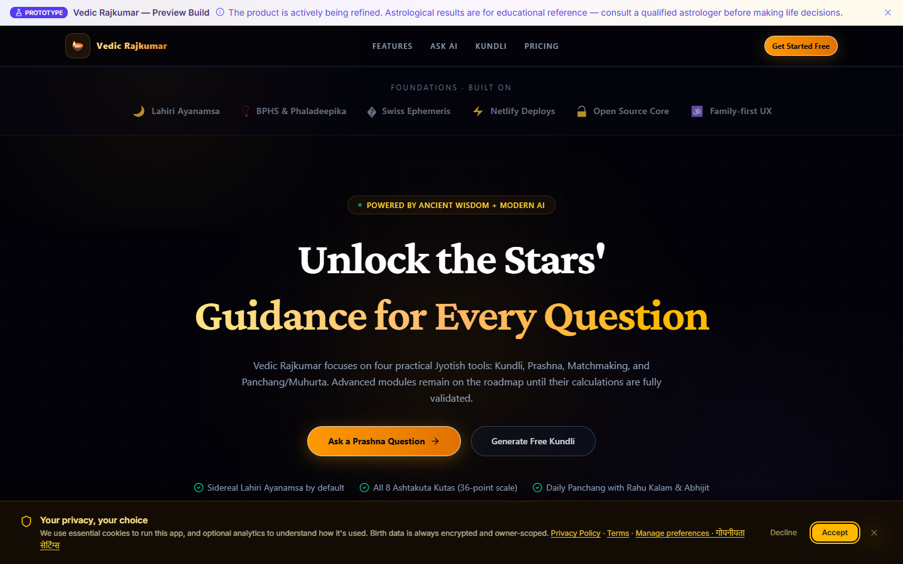
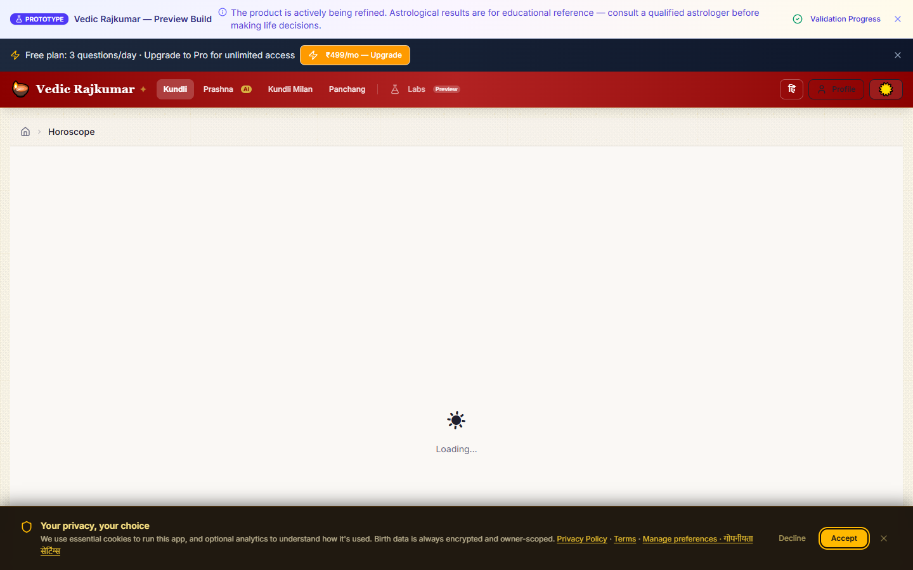
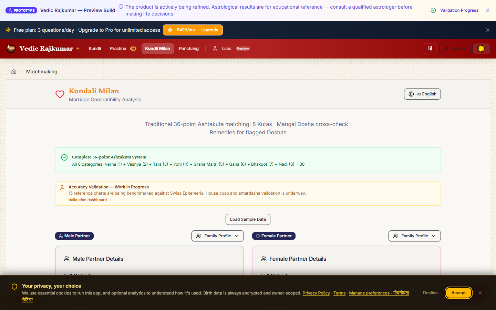
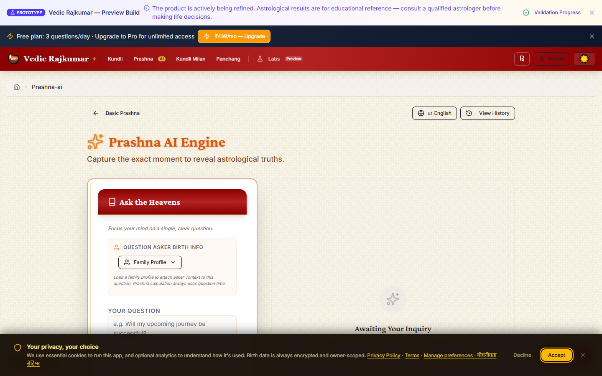
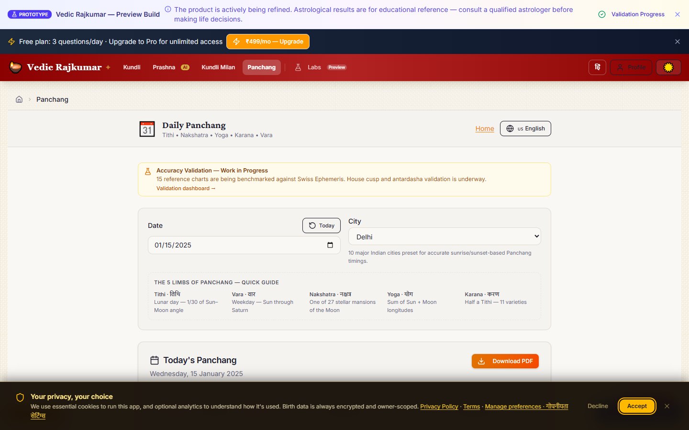
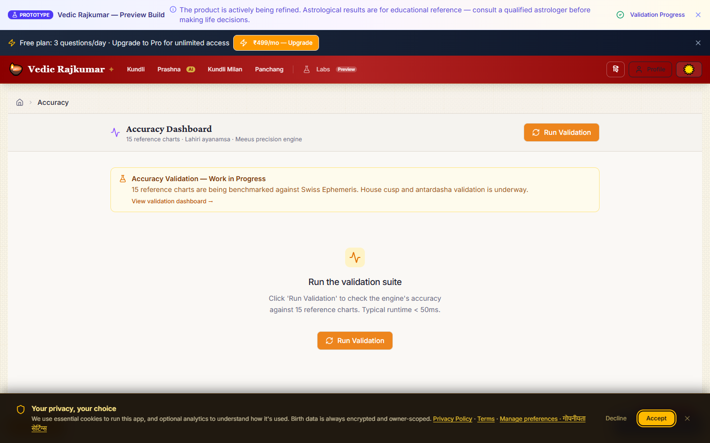
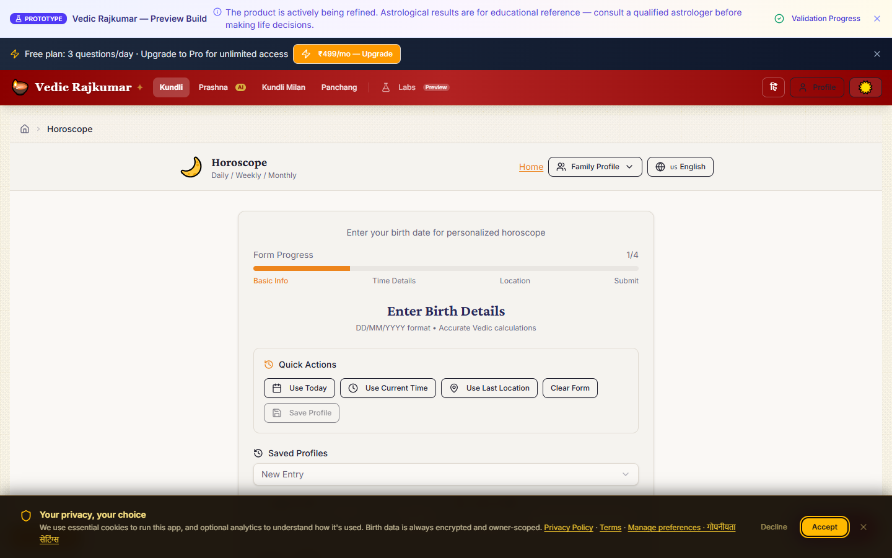
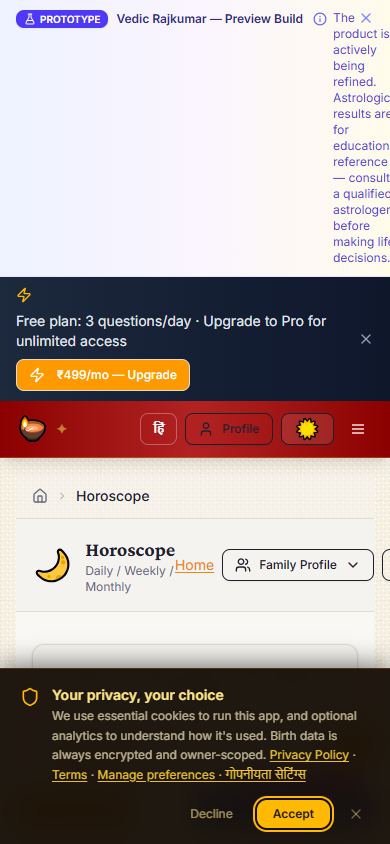
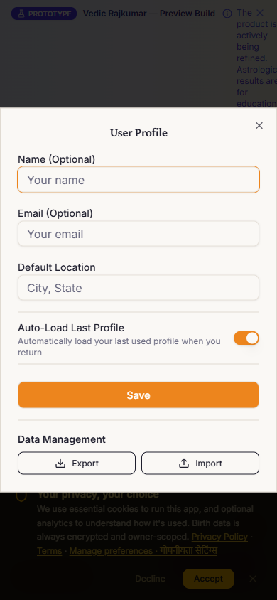

# Vedic Rajkumar

Open-source Vedic astrology (Jyotish) platform built with React, TypeScript, and modern web tooling.

**Live demo:** [vedic-rajkumar.netlify.app](https://vedic-rajkumar.netlify.app)

Casts sidereal (Lahiri ayanamsa) birth charts, prashna (horary) readings, 36-point Kundli Milan matchmaking, and Panchang/Muhurat windows — bilingual (English/Hindi), offline-capable, with optional Swiss Ephemeris precision.

---

<div align="center">

[](https://www.typescriptlang.org/)
[](https://react.dev/)
[](https://vitejs.dev/)
[](https://tailwindcss.com/)
[](https://nodejs.org/)
[](#)
[](#accuracy--testing)
[](docs/accuracy/METHODOLOGY.md)
[](https://github.com/CRAJKUMARSINGH/Vedic_Rajkumar/actions/workflows/accuracy.yml)
[](https://app.netlify.com/sites/vedic-rajkumar/deploys)
[](#license)
[](https://github.com/CRAJKUMARSINGH/Vedic_Rajkumar/issues)
[](https://github.com/CRAJKUMARSINGH/Vedic_Rajkumar/stargazers)

**Status:** Active prototype · 4 core features production-ready · 12+ advanced preview modules

</div>

---

## Key Differentiators

Vedic Rajkumar focuses on transparency, offline capability, bilingual support, and modern web technologies:

- **Transparent calculations** — every chart exposes its inputs (graha longitudes, house cusps, ayanamsa value, nakshatra padas). Intermediate data is shown rather than hidden.
- **Offline-capable** — a service worker plus local calculation engines keep the app working without a network connection after first load.
- **Bilingual** — full English and Hindi UI with correct Devanagari shaping (Noto Sans Devanagari).
- **Optional Swiss Ephemeris precision** — a build flag swaps in `swisseph-wasm` for research-grade planetary positions.
- **No account required** — demo mode runs entirely in the browser; authentication and persistence are optional.

---

## 🚀 Key Features

|     | Feature                           | What You Get                                                                                                                                                                                                                         |
| --- | --------------------------------- | ------------------------------------------------------------------------------------------------------------------------------------------------------------------------------------------------------------------------------------ |
| 🌀  | **Sidereal Kundli (Birth Chart)** | Lahiri ayanamsa · North/Central Indian layout · D1 + D9/D9 divisional charts · Nakshatra, Pada, Yogas, Shadbala, Ascendant analysis                                                                                                  |
| 🔮  | **Prashna (Horary Astrology)**    | Horary number + moment cast · Prashna Marga derived rules · Verdict with confidence score · Reading history · Synthesis overlay                                                                                                      |
| 💞  | **Kundli Milan (Matchmaking)**    | Full 36-point **Ashta Koota** (Varna · Vasya · Tara · Yoni · Graha Maitri · Gana · Bhakoot · Nadi) · Mangal Dosha checks · Breakdown tables + narrative                                                                              |
| 🌅  | **Panchang & Muhurat Finder**     | 5-limbed daily panchang (Tithi, Vaara, Nakshatra, Yoga, Karana) · Sunrise/Sunset/Rahu Kalam/Gulika · Purpose-filtered auspicious windows                                                                                             |
| 🇮🇳  | **Bilingual EN / HI**             | Full English + Hindi UI with Noto Sans Devanagari font — zero tofu boxes, correct shaping                                                                                                                                            |
| 🔍  | **Transparent Intermediate Data** | Every chart shows graha longitudes, house cusps, ayanamsa value, nakshatra padas — no hidden black boxes                                                                                                                             |
| 📄  | **Beautiful PDF Export**          | A4 Ganesh-motif kundli, matchmaking, prashna, and event reports via jsPDF — print or share                                                                                                                                           |
| 👨‍👩‍👧  | **Family Profile Mode**           | Save unlimited family member profiles — prefill any form in 1 click for repeat consultations                                                                                                                                         |
| ⚡  | **Offline-Capable**               | Service worker + local engines — works without internet after first load                                                                                                                                                             |
| 🎯  | **Accuracy Test Suite**           | **15-chart adversarial corpus** gate (wartime India, pre-IST, lat extremes, leap year, midnight) · Tier A ≤2″ ascendant · Tier B zero rashi/nakshatra failures · CI blocks regressions · [Methodology](docs/accuracy/METHODOLOGY.md) |
| 🚦  | **Modern Dev Stack**              | React 18 · TypeScript strict · Vite · Tailwind 3 · shadcn/ui Radix primitives · TanStack Query · Vitest · Playwright                                                                                                                 |
| 🔋  | **Swiss Ephemeris Ready**         | Optional `VITE_USE_SWISS_EPHEMERIS=true` flag for research-grade planetary precision                                                                                                                                                 |

---

## Screenshots

Captured from the live app: run `npm run shots` (against localhost) or `npm run shots:live` (against the deployed site). Output is written to `docs/assets/screenshots/`.

| Landing Page                                       | Kundli Birth Chart                               | Kundli Milan (Matchmaking)                                 |
| -------------------------------------------------- | ------------------------------------------------ | ---------------------------------------------------------- |
|  |  |  |

| Prashna (Horary)                                   | Daily Panchang + Muhurat                             | Accuracy Dashboard                                   |
| -------------------------------------------------- | ---------------------------------------------------- | ---------------------------------------------------- |
|  |  |  |

| Hindi UI (हिंदी)                                   | Mobile Kundli                                           | Mobile Nav                                        |
| -------------------------------------------------- | ------------------------------------------------------- | ------------------------------------------------- |
|  |  |  |

---

## ⚡ Quick Start — Under 90 Seconds

### Prerequisites

- **Node.js ≥ 22.22.1** (check with `node -v`; get it from [nodejs.org](https://nodejs.org/))
- A terminal and a browser — that's _it_. No database, no API keys required for demo mode.

### Step-by-step

```bash
# 1. Clone the repo
git clone https://github.com/CRAJKUMARSINGH/Vedic_Rajkumar.git
cd Vedic_Rajkumar

# 2. Copy env template (all vars are OPTIONAL — demo mode runs without them)
cp .env.example .env
#   Or on Windows (PowerShell):
#   Copy-Item .env.example .env

# 3. Install dependencies
npm install

# 4. Start the dev server 🚀
npm run dev
```

👉 Open **http://localhost:5173** in your browser — you'll land on the home page. Navigate to **Kundli**, fill in a birth (or use a saved jatak preset), and click **Calculate Birth Chart**. That's your first chart in under 2 minutes!

> **Optional power-ups:** Populate `.env` with Clerk + Supabase keys for auth + saved readings, or set `VITE_USE_SWISS_EPHEMERIS=true` to swap in the Swiss Ephemeris precision engine.

---

## 📖 How to Use

### 1. Cast a Kundli (Birth Chart)

1. Click **Kundli** in the navigation
2. Enter **Name · Birth Date · Birth Time · Birth City** (or click **Family Profile** to prefill)
3. Click **Calculate Birth Chart**
4. Explore: D1 chart → Divisional (D9/D10) → Planetary Positions → Nakshatra → Yogas → Dasha → **Print / Copy to PDF**

### 2. Ask a Prashna Question (Horary)

1. Click **Prashna**
2. Type your clear, focused question (e.g., _"Will I get the job I interviewed for last week?"_)
3. Enter the horary number (1–249) and the **exact moment** you asked
4. Click **Cast Prashna Kundali** — read the verdict, confidence, significators, and suggested remedies

### 3. Kundli Milan (Matchmaking Compatibility)

1. Click **Kundli Milan**
2. Enter Male Partner + Female Partner birth data (or use **Family Profile** buttons to prefill)
3. Click **Calculate Compatibility**
4. Review the 8 Ashta Koota table (36-point total), Manglik dosha flags, narrative summary, and remedies

### 4. Daily Panchang + Muhurat Finder

1. Click **Panchang**
2. Select your **city** (10 major Indian cities preset)
3. View today's 5 panchang limbs, sunrise/sunset, blocked periods (Rahu Kalam, etc.)
4. Switch to the **Muhurat** tab and filter by purpose: Marriage · Job Start · Travel · Griha Pravesh · etc.

### Useful CLI Commands

```bash
npm run dev              # Dev server (Vite hot-reload)
npm run build            # Production build to ./dist
npm run preview          # Serve the production build locally
npm run typecheck        # TypeScript strict check (no emit)
npm run lint             # ESLint across app, Supabase functions, and test sources
npm run test:run         # All Vitest tests — CI mode (1692 tests)
npm run docs:verify      # Fail if README/docs state a stale metric
npm run test:core        # Core gate tests (ephemeris + vedic engine + nav)
npm run validate:accuracy  # 15-reference-chart Swiss Ephemeris comparison
npm run test:accuracy:corpus  # 15-chart adversarial corpus gate
npm run test:accuracy:fast    # Accuracy unit tests (timeScales, cacheKey, vimshottari)
npm run test:tz-wiring        # Timezone wiring guard (fails if prod calls raw engine)
npm run migrate:chart-tz      # Dry-run timezone migration codemod
npm run ci:core          # Core tests + production build (CI pipeline)
npx playwright install chromium # One-time browser install for E2E tests
npm run test:e2e         # Starts Vite and runs Playwright E2E tests
```

---

## 🔧 Configuration & Environment Variables

All vars are **optional**. The app ships with sensible demo-mode defaults so you can run `npm run dev` instantly without touching `.env`.

| Variable                     | Default              | Purpose                                                                                                         |
| ---------------------------- | -------------------- | --------------------------------------------------------------------------------------------------------------- |
| `VITE_SUPABASE_URL`          | `''` (demo fallback) | Supabase project URL — saved readings, profile, edge functions                                                  |
| `VITE_SUPABASE_ANON_KEY`     | `''` (demo fallback) | Supabase anonymous public key                                                                                   |
| `VITE_CLERK_PUBLISHABLE_KEY` | `''` (demo fallback) | Clerk publishable key for authentication. Without it = dev demo mode, no login required.                        |
| `VITE_GA_MEASUREMENT_ID`     | `''`                 | Google Analytics 4 ID for _optional_ anonymous telemetry                                                        |
| `VITE_USE_SWISS_EPHEMERIS`   | `false`              | Set to `true` to use `swisseph-wasm` (research-grade planetary precision); otherwise uses portable local engine |

---

## 🛠 Tech Stack

| Layer                      | Technology                                                                               |
| -------------------------- | ---------------------------------------------------------------------------------------- |
| **Language**               | TypeScript 5 (strict mode — zero `any`)                                                  |
| **Frontend Framework**     | React 18 + React Router v6                                                               |
| **Build Tool**             | Vite 7 (HMR, production bundle)                                                          |
| **Styling**                | Tailwind CSS 3 + class-variance-authority + tailwind-merge                               |
| **UI Components**          | shadcn/ui patterns on Radix UI primitives                                                |
| **Icons**                  | lucide-react                                                                             |
| **State / Server Cache**   | TanStack React Query 5 + zustand-style hooks                                             |
| **Forms**                  | React Hook Form 7                                                                        |
| **Devanagari Font**        | @fontsource/noto-sans-devanagari (proper shaping, no tofu)                               |
| **Astrology Engines**      | Local `src/services/*` + `src/lib/vedic/*` (Lahiri ayanamsa) + optional `swisseph-wasm`  |
| **PDF Export**             | jsPDF 4 + jsPDF-autotable 5                                                              |
| **Auth**                   | Clerk (@clerk/react 6)                                                                   |
| **Persistence (optional)** | Supabase (auth, DB, vector store, edge functions)                                        |
| **Motion**                 | Framer Motion 12                                                                         |
| **Testing**                | Vitest + @testing-library/react + Playwright (E2E)                                       |
| **Linting / Format**       | ESLint 9 (@typescript-eslint + jsx-a11y + react-hooks)                                   |
| **Deployment**             | Netlify-ready (`netlify.toml`) + GitHub Actions CI workflow (`.github/workflows/ci.yml`) |
| **Precision Validation**   | 15-chart Swiss Ephemeris reference suite → `dist/accuracy-report.txt`                    |

---

## Architecture

```
User (browser)
      │
      ▼
React UI  ── Vite + TypeScript + Tailwind · routing · bilingual i18n
      │
      ▼
Astrology Engine  ── src/services/* · src/lib/vedic/* (sidereal Lahiri ayanamsa)
      │                Kundli · Prashna · Ashta Koota · Panchang · Dasha
      ▼
Swiss Ephemeris  ── optional swisseph-wasm precision layer
      │                planetary longitudes · house cusps
      ▼
PDF Generator  ── jsPDF (kundli, matchmaking, prashna, event reports)
      │
      ▼
Supabase  ── optional: auth, database, storage, vector store
```

| Layer              | Responsibility                                                                 |
| ------------------ | ------------------------------------------------------------------------------ |
| **UI**             | Form input, routing, language switch, chart rendering, PNG/PDF export triggers |
| **Astrology core** | Deterministic Vedic calculations on sidereal (Lahiri) coordinates              |
| **Ephemeris**      | Planetary positions and house cusps — local engine by default, Swiss optional  |
| **Reporting**      | A4 PDF generation via jsPDF                                                    |
| **Persistence**    | Optional Supabase-backed profiles, saved readings, and knowledge vectors       |

---

## 🗺 Roadmap / Planned Features

### ✅ Shipped & Production-Ready

- [x] Kundli (D1 + D9/D10) with Lahiri ayanamsa
- [x] Prashna horary engine + reading history
- [x] Kundli Milan 36-point Ashta Koota + Mangal Dosha
- [x] Daily Panchang + purpose-filtered Muhurat Finder
- [x] Bilingual English / Hindi UI (Noto Sans Devanagari)
- [x] Family Profile mode (prefill saved people in 1 click)
- [x] A4 Ganesh-motif PDF export for all 4 core features
- [x] Accuracy validation suite (15 reference charts vs Swiss Eph)
- [x] Service worker + offline-capable architecture

### 🔄 In Progress (Active Weeks 07–08)

- [ ] **Dasha + Transit Timeline** (Vimshottari mahadasha/antardasha · gochara overlay · correlation dashboard)
- [ ] **Enhanced Ashtakavarga** (Bindu charts · transit overlay · classical Brihat Parashara rules)
- [ ] **Divisional Charts Deepening** (D4, D7, D20, D60 with testable rules)

### 🔮 Coming Next (Preview Routes Exist)

- [ ] KP System (Krishnamurti Paddhati) — cuspal sublord precision
- [ ] Jaimini — Karaka, Padakrama, Chara Dasha
- [ ] Lal Kitab — red-book style remedies
- [ ] Varshaphal / Tajik — annual solar charts
- [ ] Nadi Astrology + Nakshatra-based synthesis
- [ ] Vaastu Assessment (direction · compass · dosha flags)
- [ ] Medical / Financial / Mundane Astrology panels
- [ ] Knowledge Base Ingestion + RAG (Supabase vectors)
- [ ] MTSS Enterprise Cohort Analysis dashboard
- [ ] Mobile App foundation (PWA → React Native bridge)

> 💡 **Got a feature idea?** Open a [Feature Request](#-want-to-add-something)!

---

## 🎯 Accuracy & Testing

Vedic Rajkumar ships a published, reproducible accuracy corpus.

### What makes it trustworthy

| Claim                       | Evidence                                              |
| --------------------------- | ----------------------------------------------------- |
| Lahiri ayanamsa precision   | ≤ 0.1″ across 15 corpus charts                        |
| Ascendant precision         | ≤ 2.0″ across all charts including lat 64°            |
| Rashi/nakshatra correctness | Zero Tier B failures in the corpus gate               |
| Historical India timezone   | Wartime (+6:30), IST, HMT, LMT all handled            |
| Pre-1947 accuracy           | 1935 Bombay Time, 1943 wartime, 1936 leap year tested |
| Regression gate             | CI fails on any rashi or nakshatra mismatch           |

### What is not yet independently verified

Yogas · Shadbala · Ashtakavarga · Divisional charts (Varga) · Interpretation prose.
These are deterministic transforms — the risk is a formula bug, not astronomical error.
They are the next layer to gate. See [`docs/accuracy/METHODOLOGY.md`](docs/accuracy/METHODOLOGY.md).

### Running the accuracy suite

```bash
npm run test:accuracy:corpus   # 15-chart adversarial corpus gate
npm run test:accuracy:fast     # Unit tests: delta-T, cache keys, Vimshottari
npm run test:tz-wiring         # Guard: all production code routes through timezone-aware wrapper
npm run validate:accuracy      # Original 15-reference-chart Swiss Ephemeris suite
```

### Published report

`npm run accuracy:publish` re-derives the numbers from the corpus and the Swiss
Ephemeris golden data and writes `src/generated/summary.json`, which the
[/accuracy](src/pages/AccuracyDashboardPage.tsx) page renders verbatim — every
body's observed arcsecond error next to its advertised claim, the nakshatra
boundary exposure, the delta-T floor, and an explicit list of **what is not
verified**. `npm run ship` publishes then builds; `netlify.toml` does the same so
production never ships a stale snapshot. See [`docs/ACCURACY_PAGE.md`](docs/ACCURACY_PAGE.md).

The **critical bug found and fixed** in this codebase: `calculatePreciseChart` defaulted to IST (+5:30) for all historical charts. For a 1943 Mumbai birth at 04:27, the wartime offset was +6:30 — **1 hour different, ~16.5° of ascendant error, wrong rashi entirely**. Every Jyotish app that hardcodes IST has this bug. Ours doesn't.

---

## 📌 Standing Instructions — Continuity Log (`CREAT.MD`)

These are **standing instructions** for every human engineer and every AI tool
working on this repository. They apply to all sessions until explicitly revoked.

1. **Source of work items.** Apply the instructions contained in
   [`vedic-vijay/`](vedic-vijay) — every `*.TXT` and `*.MD` file in that folder
   (e.g. [`Vedic24.txt`](vedic-vijay/Vedic24.txt), [`Tex21.txt`](vedic-vijay/Tex21.txt),
   [`Vedic22oct.md.txt`](vedic-vijay/Vedic22oct.md.txt),
   [`NO-BEATING-ABOUT-THE-BUSH.TXT`](vedic-vijay/NO-BEATING-ABOUT-THE-BUSH.TXT),
   [`enrichment code.md`](vedic-vijay/enrichment%20code.md)). Treat them as the
   authoritative brief for the current work.
2. **Maintain [`CREAT.MD`](CREAT.MD)** at the repository root as the shared
   **chat log** so that tools and software engineers work in harmony and
   continuity is never lost. Append a new entry at the **top** of the log for
   each session: date/time, what was done, which files changed, what is next.
3. **Retention = last 24 hours only.** `CREAT.MD` keeps only the _immediate /
   last 24 hours_ of work. Any **lengthy earlier / old record must be deleted**
   from `CREAT.MD` when a new entry is written. The file stays short by design —
   it is a rolling window, not an archive.
4. **Never let `CREAT.MD` go stale.** If you did work, log it before you stop.
5. **CONFIDENTIALITY — hard constraint.** Seed-bank birth data and everything
   derived from it is **private**. The code must not reveal seed-bank details
   (name, date/time of birth, place, coordinates, or any chart/verdict derived
   from them) to any random user — **only the authenticated admin** (a
   `ROLE_DEFINITIONS[role].isAdmin === true` role — `owner`/`admin` — from
   `src/auth/roles/config.ts`). **One user's birth data must never be shared with
   another user.** Therefore: never place seed data in `public/` (world-readable);
   deny by default for new endpoints, artifacts, bundles and logs; redact raw
   birth fields for non-admin callers; and remember that a client-side check is
   UX, not authorization — enforcement belongs on a server or it does not exist.
   These rules apply to every feature, including the Answer Layer.

---

## 🏗 Contributing

- 🌿 Git workflow (feature branches, never commit to main)
- ✅ PR checklist & code quality standards
- 🧪 Writing tests for calculation engines
- 🌐 Adding Hindi translations

…see **[CONTRIBUTING.md](./CONTRIBUTING.md)**.

### Quick Contributing Workflow

```bash
# Fork & clone
git checkout main
git pull origin main
git checkout -b feature/your-idea-name

# Make your changes + verify
npm run typecheck
npm run lint
npm run test:core
npm run build

# Commit, push, open PR against main
```

---

## 🧑‍⚖️ Code of Conduct

This project follows the **Contributor Covenant v2.1**. We are committed to a safe, respectful, inclusive community — especially for astrology-curious users, beginners, and diaspora members who might otherwise feel judged for asking questions.

**Read the full Code of Conduct:** [CODE_OF_CONDUCT.md](./CODE_OF_CONDUCT.md)

---

## 🔐 Privacy & Security

Vedic Rajkumar handles **personally identifiable birth data** (names, birth dates/times/places). We take this seriously.

- **Demo mode** (`.env` blank): 100% local browser — _nothing_ leaves your device. Nothing is sent anywhere.
- **With Supabase**: only your explicitly saved profiles/readings are stored, subject to Supabase RLS policies.
- **With Clerk**: authentication only — birth data never touches Clerk.

**Responsible disclosure:** If you find a security issue, **do NOT open a public issue**. Email the maintainers privately per the instructions in [SECURITY.md](./SECURITY.md). We'll acknowledge within 48h and issue a fix within 14 days.

---

## 📜 License

Vedic Rajkumar is open-source software released under the **MIT License**.

See [LICENSE](./LICENSE) (or the OSI [MIT summary](https://opensource.org/licenses/MIT)) for full terms.

---

## ❤️ Shout-outs & Thanks

### 🙏 Traditional & Scholarly

- **Maharishi Parashara** — _Brihat Parashara Hora Shastra_, the foundation of modern Jyotish
- **Varahamihira** — _Brihat Jataka_ and _Pancha Siddhantika_
- *_Garga_ and the Vedic Rishis who preserved this knowledge orally for millennia

### 🔬 Engineering

- The **Swiss Ephemeris** team ([Astrodienst](https://www.astro.com/swisseph/)) — the gold standard for astronomical calculation
- **shadcn/ui** + **Radix UI** — beautifully accessible primitives
- **Vite, React, TypeScript, Tailwind** maintainers — a pleasure to build with

### 👥 Community

- The 15+ reference jataks from classical texts used in the accuracy validation suite
- Early pilot users in Delhi, Mumbai, Bengaluru, London, and Toronto who gave real UX feedback during Weeks 1–8
- **You**, for reading this far and considering this project ⭐

---

## Supporting the Project

- **Star the repository** if you find it useful.
- **Fork it** to adapt it to your region, language, or Jyotish tradition.
- **Open an issue** for bugs or rules that look incorrect.
- **Submit a PR** per [CONTRIBUTING.md](./CONTRIBUTING.md).
