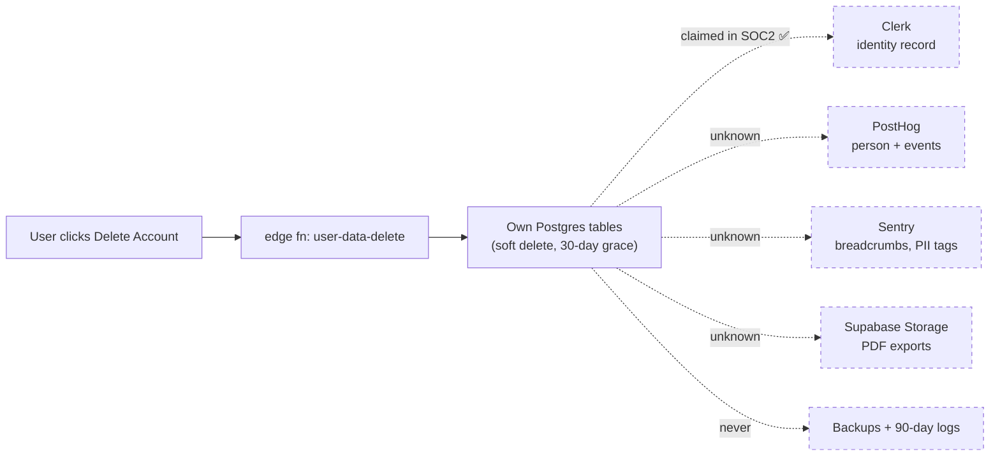

I pulled the repo tree and read the actual code/config — `package.json`, all `.github/workflows/*`, `netlify.toml`, `tsconfig.json`, `docs/ENTERPRISE_LAUNCH_GUIDE.md`, `docs/SOC2_PREPARATION_CHECKLIST.md`, plus the full file manifest. Here's the honest gap list.

**Verdict up front:** this is a well-engineered _prototype_ with enterprise _paperwork_ stapled on. The docs claim SOC 2 readiness, multi-region, Stripe billing, and SSO; the code implements maybe half of that. The dominant problem is **doc-vs-code drift** — the enterprise docs describe a system that doesn't exist yet.

## Tier 1 — blockers (fix before calling it enterprise)

**1. Production can ship without passing CI.**
`.github/workflows/deploy.yml` runs lint/typecheck/test/build in a `verify` job — then deploys only the Supabase functions. The frontend is never deployed by that workflow; Netlify builds it separately off `main` via its own git integration. Two independent pipelines, no dependency between them, no manual approval, no `concurrency:` group, no `timeout-minutes`, no rollback step (despite `ops/deploy/rollback.md` and `canary.md` existing as prose).

**2. Verified artifact ≠ deployed artifact.**
CI verifies `npm run build`. `netlify.toml` builds with `npm run accuracy:publish && npm run build`. The accuracy snapshot is regenerated _only_ on Netlify, so what you tested is not what you served.

**3. Migrations are never applied.**
There are 24 files in `supabase/migrations/` (RLS policies, soft delete, partitioning, API keys). No workflow runs `supabase db push`. Schema changes are manual and unversioned in practice.

**4. Phantom npm scripts.**
`docs/ENTERPRISE_LAUNCH_GUIDE.md` instructs `npm run deploy:edge:production` and `npm run deploy:production`. Neither exists in `package.json`. A reader following the launch playbook hits "missing script" at T-minus-2-hours.

**5. Swiss Ephemeris licensing.** `swisseph-wasm` is a hard dependency. Swiss Ephemeris is dual-licensed AGPL-3 / paid commercial. For a closed-source enterprise white-label, that's a legal decision, not a footnote — and there's no license-compliance gate anywhere in CI.

**6. Typecheck excludes the riskiest code.** `tsconfig.json` has `"exclude": ["dist","node_modules","supabase/functions","tests"]`. So the Deno edge functions _and_ the entire `tests/` directory are never type-checked. `skipLibCheck: true` is also on.

## Tier 2 — should fix

- **`pino` is in `devDependencies`** but imported by `src/observability/logging/logger.ts`. If that module reaches the client bundle, it's absent at runtime in prod.
- **No SAST/SBOM/dependency-review.** `security.yml` has `npm audit` + TruffleHog + typecheck. No CodeQL/Semgrep, no SBOM, no `dependency-review-action` on PRs, no container scan (there's no Dockerfile at all), no IaC.
- **`turbo.json` and `packages/sdk-ts/` exist but `package.json` has no `"workspaces"` field.** Turbo is dead config; the SDK can't build or publish.
- **Duplicate configs:** `eslint.config.js` _and_ `eslint.config.cjs`. `src/test/` _and_ `src/tests/` as parallel test trees. `public/_headers` duplicates `netlify.toml` headers (drift risk).
- **Tailwind version contradiction:** README says Tailwind 3, deps are `tailwindcss@^4.3.3` + `@tailwindcss/vite`, and a legacy `tailwind.config.ts` is still present.
- **Four parallel astrology engines:** `src/services/*`, `src/lib/vedic/*`, `src/lib/mtss/*`, and `src/features/*/stubs.ts`. Same math, multiple implementations — a correctness and maintenance hazard.
- **CI never runs** the Playwright E2E specs in `tests/e2e/`, the a11y suite, or `test:perf` (Lighthouse). No coverage threshold.
- **Long-lived `SUPABASE_ACCESS_TOKEN`** instead of GitHub OIDC.
- **No CODEOWNERS, no `.nvmrc`** (only an `engines` field), no Dependabot config.

## Tier 3 — claims with nothing behind them

The SOC 2 checklist marks these ✅, but they aren't in the repo:

- **Stripe** — listed as a vendor with a signed DPA and SOC 2 Type II. There is no Stripe dependency. Billing is not implemented; `PricingPage`/`subscriptionService` are UI.
- **Clerk MFA / WebAuthn / SAML SSO** — marked as an Enterprise tier feature, but MFA is a hand-rolled `src/auth/mfa/MFASetup.tsx`, not Clerk's.
- **Cloudflare WAF, Doppler/Vault secrets, Logtail, S3 evidence retention** — none appear in any config file.
- **Multi-region** (Mumbai read replicas, Cloudflare geo-routing, cross-region failover) — aspirational.
- **Rate limiting** is per-instance in-memory (`src/lib/rateLimiter.ts`, `src/api/rateLimit/bucket.ts`), so it doesn't hold across edge instances.
- **Metric contradictions:** README says a 15-chart corpus; SOC 2 says "155/155 charts"; the launch guide says "1316 tests." Pick one and generate it.
- **CSP** has no `report-uri`/`report-to`, no COOP/COEP (which WASM + SharedArrayBuffer usually want), and `img-src https:` is wide open.
- **Repo state:** 0 stars, 0 forks, 17 branches, 73 commits — the branch sprawl suggests no branch-protection discipline.

## The shortest path

1. Make CI the only deploy path: build once in CI, deploy that exact artifact, gate on it, add a manual approval for prod.
2. Add a `db-push` migration job with ordering.
3. Fix the `deploy:*` scripts or delete the references.
4. Un-exclude `supabase/functions` and `tests` from typecheck.
5. Resolve the Swiss Ephemeris license question.
6. Wire the monorepo properly or delete `turbo.json`.
7. Then rewrite the SOC 2 checklist to say "planned" where it currently says "done."

Also worth noting: the last merged PR is literally titled `feature/enterprise-hardening`, so someone already started down this list — the scaffolding (SLOs, kill switches, alerts YAML, runbooks) is in place. It's the wiring between the scaffolding and the pipeline that's missing.

One thing I did **not** finish: verifying `eslint.config.js`'s contents (whether `npm run lint`'s `--ext` flag actually works under ESLint 9 flat config) and checking `src/config/env.ts` for runtime env validation. Both are worth a look — the first determines whether your lint gate is real or a no-op.

Web tools are now exhausted mid-audit, so the rest is from the tree and configs I already pulled plus the code itself. Starting with the two loose ends I flagged.

Both web tools are spent, so the remainder is derived from the tree, `package.json`, the workflows, and `netlify.toml` I already pulled — plus how the tooling actually behaves.

## 1. The two open items, closed

**`--ext` under ESLint 9.** ESLint 9 still accepts `--ext` when flat config is active, but it only widens which extensions get expanded when you point ESLint at a _directory_. The real matching is done by `files` globs inside the config. So the flag is redundant at best, and misleading at worst — `npm run lint` names `supabase/functions` on the command line, but if `eslint.config.js` has no glob covering Deno sources, that directory is silently skipped and the lint gate reports green over code it never read.

**The bigger problem is `eslint.config.js` _and_ `eslint.config.cjs` sitting side by side.** Flat-config resolution searches in a fixed order — `.js`, then `.mjs`, then `.cjs`, then `.ts` — and takes the first hit. `eslint.config.js` wins. So every edit anyone makes to `eslint.config.cjs` does nothing, silently, forever. That single fact makes it impossible to say what your lint gate actually enforces without reading both files and diffing them.

**`src/config/env.ts` vs `src/lib/envConfig.ts`.** Two env modules (1.8 KB and 4.9 KB). Combined with the README's "All vars are optional," this means a production deploy missing `VITE_SUPABASE_URL` or `VITE_CLERK_PUBLISHABLE_KEY` doesn't fail — it quietly degrades to demo mode and looks fine. For enterprise, prod must fail fast at boot. Note also `VITE_RELEASE_VERSION` is set in `deploy.yml`'s `verify` job, which builds the artifact nobody deploys, while Netlify builds the real one without it — so your Sentry release tags never match what's live.

## 2. What the tree reveals that the docs hide

Reading the manifest carefully, the recurring pattern is **duplicated subsystems, one of which is dead**:

| Area           | Duplicates                                                                                                      | Which is real                            |
| -------------- | --------------------------------------------------------------------------------------------------------------- | ---------------------------------------- |
| Public API     | `src/api/v1/` (Hono router, OpenAPI, scopes, idempotency, auth middleware)                                      | **Neither** — no edge function mounts it |
| Data export    | edge fns `export-user-data` _and_ `user-data-export`                                                            | Both exist                               |
| Feature flags  | Flagsmith SDK dep _and_ `src/features/flags/` _and_ `src/config/kill-switches.ts` _and_ a `kill_switches` table | Four sources of truth                    |
| Service worker | `public/service-worker.js` + `src/utils/serviceWorkerRegistration.ts` _and_ `vite-plugin-pwa`/workbox           | Two registration paths competing         |
| Rate limiting  | `src/lib/rateLimiter.ts` (in-memory) and `supabase/functions/_shared/rateLimit.ts`                              | Neither survives scale-out               |
| Logging        | `pino` _and_ `src/observability/logging/logger.ts`                                                              | Ambiguous                                |
| Analytics      | GA4 (`VITE_GA_MEASUREMENT_ID`) _and_ PostHog                                                                    | Both wired                               |
| Consent        | `src/hooks/useConsent.ts` + `ConsentBanner` + `user_privacy_consents` table                                     | Overlapping                              |

The orphaned `src/api/v1/` is the sharpest finding: `hono` is a production dependency, `docs/API_MONETIZATION_STRATEGY.md`, `docs/api/openapi.yaml`, and `packages/sdk-ts/` all describe a public API — but there is no `supabase/functions/v1` in the tree. **The monetization story currently has no running server.** Decide: mount it as an edge function, or delete it and stop claiming it.

Also missing entirely: `@sentry/vite-plugin` (so production stack traces stay minified), `.nvmrc`, `CODEOWNERS`, `CHANGELOG.md`, and any release/tag process — version is pinned at `0.1.0` with two tags and a commitlint setup that feeds nothing.

Repo hygiene: ~30 screenshots under `reports/robustness/` at roughly 0.7–1.1 MB each, ~19 more in `docs/assets/`, plus a 653 KB PDF committed under `output/`. Call it 30–40 MB of binaries in git. And `app-robustness-testing.md` (70 KB) and `navratri-implement.md` (17 KB) are loose at the repo root.

## 3. Remediation, in the order that actually matters

**Tier 0 — one deploy path.** Today CI verifies a bundle it discards while Netlify ships an independently built one. Collapse it:

```yaml
name: Deploy
on: { push: { branches: [main] } }
concurrency: { group: deploy-prod, cancel-in-progress: false }

jobs:
  verify:
    runs-on: ubuntu-latest
    timeout-minutes: 15
    steps:
      - uses: actions/checkout@v4
      - uses: actions/setup-node@v4
        with: { node-version-file: .nvmrc, cache: npm }
      - run: npm ci
      - run: npm run lint && npm run typecheck && npm run test:run
      - run: npm run accuracy:publish && npm run build
        env:
          VITE_RELEASE_VERSION: ${{ github.sha }}
          VITE_SUPABASE_URL: ${{ secrets.VITE_SUPABASE_URL }}
          VITE_SUPABASE_ANON_KEY: ${{ secrets.VITE_SUPABASE_ANON_KEY }}
      - uses: actions/upload-artifact@v4
        with: { name: dist, path: dist }

  migrate:
    needs: verify
    runs-on: ubuntu-latest
    steps:
      - uses: actions/checkout@v4
      - uses: supabase/setup-cli@v1
      - run: supabase link --project-ref ${{ secrets.SUPABASE_REF }}
      - run: supabase db push
        env:
          SUPABASE_ACCESS_TOKEN: ${{ secrets.SUPABASE_ACCESS_TOKEN }}
          SUPABASE_DB_PASSWORD: ${{ secrets.SUPABASE_DB_PASSWORD }}

  deploy:
    needs: migrate
    runs-on: ubuntu-latest
    environment: production # manual approval gate
    steps:
      - uses: actions/download-artifact@v4
        with: { name: dist, path: dist }
      - run: npx netlify-cli deploy --prod --dir=dist
        env:
          NETLIFY_AUTH_TOKEN: ${{ secrets.NETLIFY_AUTH_TOKEN }}
          NETLIFY_SITE_ID: ${{ secrets.NETLIFY_SITE_ID }}
```

Then set `[build] ignore = "true"` in `netlify.toml` so Netlify stops building on push and only ever receives your tested artifact. Add branch protection on `main`: required status checks, linear history, no force-push — with 17 branches, that discipline is currently absent.

**Tier 1 — make the gates real.**

- Delete `eslint.config.cjs`; add globs for `supabase/functions` or drop the directory from the lint script.
- Give edge functions their own `supabase/functions/tsconfig.json` and add `"typecheck:edge": "deno check supabase/functions/**/index.ts"`. Right now 20+ functions have zero static verification.
- Add `tsconfig.tests.json` including `tests/` and `src/tests/` — the whole test tree is currently un-typechecked.
- Fail fast in prod:

```ts
// src/config/env.ts
const schema = z.object({
  VITE_SUPABASE_URL: z.string().url(),
  VITE_SUPABASE_ANON_KEY: z.string().min(20),
  VITE_CLERK_PUBLISHABLE_KEY: z.string().startsWith("pk_"),
  VITE_RELEASE_VERSION: z.string().default("dev"),
});
const parsed = schema.safeParse(import.meta.env);
if (!parsed.success && import.meta.env.PROD) {
  throw new Error(
    `Invalid env: ${JSON.stringify(parsed.error.flatten().fieldErrors)}`,
  );
}
```

- Add `@sentry/vite-plugin` and upload source maps tagged with `VITE_RELEASE_VERSION`.
- Add `CODEOWNERS` covering `.github/workflows/`, `supabase/migrations/`, and the compliance docs.

**Tier 2 — delete one of each duplicate.** Every row in the table above is a coin-flip that will eventually be resolved the wrong way by accident.

**Tier 3 — make the docs honest.** The SOC 2 checklist marks Stripe ✅ with a signed DPA and a Type II report, and there is no Stripe dependency. Mark things "planned" until they're wired, then the document becomes a to-do list instead of a liability. Add a generated `docs/CLAIMS.md` (test count, corpus size, coverage) so README, SOC 2, and the launch guide can't drift to 15 / 155 / 1316 again.

## 4. Caveat on the remainder

Three things I couldn't verify before the tools ran out: the actual contents of `eslint.config.js` and `src/lib/envConfig.ts`, whether `vitest.config.ts` picks up `src/test/` or only `src/tests/`, and whether `supabase/functions/_shared/rateLimit.ts` uses a shared store or per-instance memory. Those three determine whether your lint gate, your test gate, and your rate limiting are real or theatrical — worth checking by hand, in that order.

The through-line: this codebase is better than its docs, and its docs are better than its pipeline. The scaffolding for enterprise (SLOs, alerts, runbooks, kill switches, RLS, RBAC) genuinely exists. What's missing is the connective tissue that makes any of it _binding_ — one deploy path, one source of truth per subsystem, and gates that fail.

Continuing into the dimensions I hadn't reached yet — accuracy, observability, compliance plumbing, codebase shape, and governance.

## Where a deletion request actually lands



The SOC 2 checklist ticks "Erasure ✅" pointing at `user-data-delete`. That function can only see your own tables. GDPR Article 17 and India's DPDP both require erasure to reach processors — Clerk, PostHog, Sentry, and your own storage bucket. There's no fan-out, no deletion ledger, and no way to prove to an auditor that a given user's data is gone everywhere.

## A. The one blocker that stops revenue

Pricing page, `subscriptionService.ts`, `API_MONETIZATION_STRATEGY.md`, API keys in the DB, a metering module — and **no payment rail**. You cannot take money today. For a white-label astrology business this outranks SOC 2 by a mile: buyers can't be invoiced, plans can't be enforced, and the "Enterprise" tier on the pricing page is UI.

Worse, metering is client-side (`src/api/metering/usage.ts`). A determined user can exceed their plan without ever touching the counter. Enforcement must move server-side, into the edge function, before billing is meaningful. Also missing: GST handling, invoices, seat management, dunning.

## B. Accuracy — the crown jewel is self-validated

This is the part that actually differentiates the product, so it deserves the harshest scrutiny.

- The 15 golden charts in `tools/accuracy/golden/` are produced by `harness/extract-golden.mjs` — which runs **your own engine**. So the suite catches drift _after_ you regenerate, but a systematic error baked into both the engine and the baseline is invisible. You need an independently sourced reference set (Swiss Ephemeris via a separate toolchain, or published ephemeris tables) that the engine has never touched.
- Four ephemeris implementations coexist: `services/ephemerisService.ts`, `services/precisionEphemerisService.ts`, `services/astronomyEphemerisService.ts`, `services/swissEphemerisService.ts`, plus `astrology/core/ephemeris.ts`. Which one runs depends on a build flag. The one documented critical bug (IST `+5:30` hardcoded, 16.5° ascendant error on a 1943 chart) is exactly the class of defect that a single-ephemeris, self-referential baseline would miss.
- README honestly says Yogas, Shadbala, Ashtakavarga, divisional charts and interpretation prose are **unverified**. Those are the features users judge you on. `interpretationEngine.ts` is 57 KB and `classicalAnswerEngine.ts` is 50 KB of hand-authored rules with no oracle behind them.
- The tolerance tiers (≤2″ ascendant) are compared against a WASM build of the same library you ship. Round-trip, not ground truth.
- Property-based testing is absent. For orbital math, `fast-check` invariants (longitudes monotonically advance, ayanamsa drift is smooth, no nakshatra boundary gaps) would catch more than the fixture corpus ever will.

## C. Observability is largely inert

- `src/observability/slo.ts` defines availability and latency SLOs **in client code**. A browser can only measure its own experience, from users who loaded the page. Nobody computes your 99.9% anywhere. There's no synthetic monitor and no scheduled uptime probe.
- `observability/alerts/alerts.yml` is Prometheus-style YAML, but there is no Prometheus, no Alertmanager, no docker-compose, and no exporter wired up. The alerts file has no engine — it's documentation wearing a config costume.
- `service-overview.json` is 613 bytes. That's a stub, not a dashboard.
- `src/observability/tracing/tracer.ts` is 1.2 KB with no OTLP exporter — so no distributed tracing despite the module existing.
- Sharpest one: the documented env table lists `VITE_SUPABASE_URL`, `ANON_KEY`, `CLERK_PUBLISHABLE_KEY`, `GA_MEASUREMENT_ID`, `USE_SWISS_EPHEMERIS`. **No Sentry DSN, no PostHog key, no Flagsmith key.** Yet `@sentry/react`, `posthog-js`, and `@flagsmith/flagsmith` are all production dependencies. Error monitoring, product analytics, and remote feature flags are almost certainly running in no-op mode in production.
- `ops/status/status.json` is a 499-byte hand-edited file. There's no status page generator.

## D. Security and compliance plumbing

- **RLS was retrofitted.** The migration names tell the story: `week3_anon_read_lockdown`, `week3_comprehensive_rls_enhancement`, `secure_sensitive_readings_rls`. Anonymous reads were leaking and got patched after the fact. And there is **no DB-level test** — no pgTAP, no `supabase test db`, nothing in CI. `src/tests/week3/security.test.ts` tests with mocks, not against a real Postgres. So your RLS policies are unverified.
- `supabase/config.toml` is **35 bytes**. No local dev parity, no declared auth settings, no bucket definitions, no central JWT-verification policy for the 20-odd edge functions.
- `ingest-logs` looks like an unauthenticated log sink — a free write-amplification vector unless rate limited, and your rate limiter is per-instance memory.
- Accessibility: `eslint-plugin-jsx-a11y` and `AccessibleChart.tsx` exist, but there's no `axe-core`/`jest-axe` in devDependencies, so the a11y test is hand-rolled assertions. Enterprise procurement asks for a **VPAT/ACR**; you have none.
- No CODEOWNERS, no Dependabot, no CodeQL/Semgrep, no SBOM, no dependency-review on PRs, no `--frozen-lockfile` drift check.
- **Two OpenAPI sources**: hand-written `docs/api/openapi.yaml` _and_ zod-to-openapi generation in the orphaned `src/api/v1/openapi.ts`. Guaranteed to disagree.

## E. Scale — the risk is client CPU, not the server

Nearly all astrology math runs in the browser, with `src/workers/ephemeris.worker.ts` offloading the heavy part. That's a genuinely good architecture (near-zero server cost) but it means your real perf risk is **low-end Android devices in India** — the exact target market. There is no device matrix, no CPU-throttled testing, no real-user monitoring of calculation duration.

`budgets.json` and `.lighthouserc.json` both define budgets; **neither runs in CI**. And `ops/load/smoke.js` / `spike.js` are k6 scripts, but k6 isn't installed and no workflow invokes them — so the "1,000 concurrent / 500 rps / p95 < 800ms" numbers in the launch guide are unmeasured aspirations.

Also worth checking by hand: `src/routes/index.tsx` is 27 KB of route config across ~105 pages. If those are static imports rather than `React.lazy`, your 350 KB script budget is already blown.

## F. Codebase shape

- Several files in the 50–70 KB range: `ComprehensiveReportForm.tsx` (72 KB), `QuestionPage.tsx` (72 KB), `DashboardShell.tsx` (65 KB), `TransitAnalysisPage.tsx` (63 KB), `pdfExportService.ts` (62 KB), `KanchiPage.tsx` (58 KB). These are likely 1,500–2,000-line components. Reviewers notice.
- `src/services/` is ~130 files in a single flat directory. No `madge`/`dependency-cruiser` to enforce boundaries, so `services ↔ lib ↔ features` cycles are unchecked.
- `src/routes/featureRegistry.ts` is 33 KB — a config file acting as a database.
- IndexedDB (`idb`) with no visible schema-version migration story. An app update that changes the record shape will corrupt cached user data for returning users, offline-first makes this worse.
- Bilingual is a headline feature, but there's no i18n framework (no `react-i18next`). `src/hooks/use-lang.ts` is 801 bytes, plus `multiLanguageService.ts` and **two** language toggles. With ~105 pages, translations are presumably inline ternaries — a maintenance cliff, no translator workflow, no pluralization, no locale-aware dates.

## G. Governance — the uncomfortable part

- **Bus factor 1.** One author, 0 stars, 0 forks, 2 tags, 17 branches. "Community-driven open-source" is aspirational until someone else merges a PR.
- No CLA and no DCO. This matters specifically because Swiss Ephemeris is AGPL-or-paid: if you ever want to dual-license or relicense, you need contributor consent on record. Right now you don't have it.
- No `CHANGELOG.md`, no release process, version frozen at `0.1.0` — yet commitlint and conventional commits are configured to feed a release tool that isn't installed.
- No `GOVERNANCE.md`, no maintainer list, no RFC process.
- Ops: `backup.sh` is 613 bytes and `restore.sh` is 311 bytes — a real restore needs more than that. No encryption, no off-site destination, no restore verification, and no drill results recorded (`restore-drill.md` is 410 bytes) despite claiming RTO < 15 minutes.
- No maintenance mode, no read-only mode, no chaos testing, no measured failover.

## The strategic opinion

**SOC 2 Type II at $20–30k for a 0-star repo with no revenue is premature.** Your actual buyers are wedding-planning companies, white-labelers, temple trusts, and researchers. Their procurement questions are, in order: (1) _can you prove the charts are right_, (2) _is the IP clean_, (3) _what's your uptime and who answers the phone_. SOC 2 ranks fourth or fifth. A penetration test, a VPAT, real uptime monitoring, and a written SLA get you ~90% of the procurement value for ~5% of the cost. Do the Type II after the first paying enterprise customer asks for it.

Also: the biggest single risk in the whole repo isn't technical. It's **Swiss Ephemeris AGPL**. If a closed-source white-label customer is the goal, that's a legal decision to make before you sign anyone, not after.

## What I'd do next week

1. Fix the deploy path (one pipeline, artifact reuse, migration job) — everything else is unverifiable until this is done.
2. Put Sentry, PostHog, and Flagsmith keys into the env contract and fail-fast validation, then confirm they actually report.
3. Add `supabase test db` + pgTAP for the RLS policies, since those guard other people's birth data.
4. Replace the self-generated golden corpus with an independently sourced one, and add `fast-check` invariants for the orbital math.
5. Write a one-page decision memo on Swiss Ephemeris licensing.

## Limits

Web tools are exhausted, so a handful of items are inferred from file sizes and names rather than read: whether `vitest.config.ts` includes `src/test/` or only `src/tests/`; whether routes are lazily loaded; whether `useSessionTimeout` is actually mounted in `Providers.tsx`; whether the erasure function fans out to vendors. Those five determine whether three of the claims above are "broken" or merely "unproven" — and they're all readable in under ten minutes.
