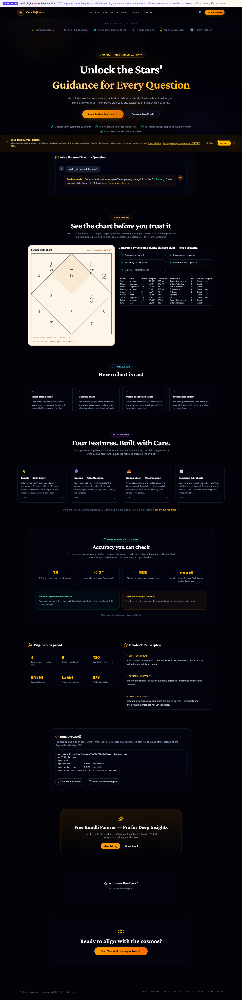
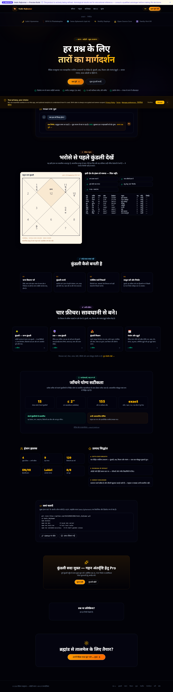
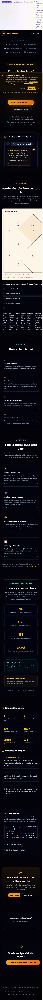

# LOVABLE HUB ADOPTION REPORT — Landing-Page Selective Enrichment

**Repository:** `E:\Rajkumar\Vedic_Rajkumar`
**Reference design:** `https://vedic-rajkumar-repository-hub.lovable.app/`
**Date:** 2026-11-21
**Commit base:** `5dfbebf` (main) `+dirty`
**Status:** ✅ Implemented and verified · 🔴 **RELEASE HOLD — not pushed, merged or deployed**

---

## 0. Summary

The existing landing page ([LandingPageV3.tsx](file:///e:/Rajkumar/Vedic_Rajkumar/src/pages/LandingPageV3.tsx))
was **enriched**, not replaced. All nine information-architecture concepts from the
Lovable Repository Hub are now present, built from existing components, tokens and
the canonical chart engine. No calculation engine, security boundary or feature flag
was altered. Every numeric claim on the page is pinned to
[docs/CLAIMS.md](file:///e:/Rajkumar/Vedic_Rajkumar/docs/CLAIMS.md) or
[docs/accuracy/METHODOLOGY.md](file:///e:/Rajkumar/Vedic_Rajkumar/docs/accuracy/METHODOLOGY.md).

Three claims that the reference hub publishes were **not** copied because they are not
supported by the repository (see §2 and §10): the stale test count ("2,620"), the
implied *live* Swiss-Ephemeris comparison, and listing Shadbala as a finished feature.

One real accessibility defect was found and fixed while validating the new preview
(§5): the canonical chart rendered focusable `role="button"` groups inside a
`role="img"` SVG (axe `nested-interactive`).

---

## 1. Scope & method

| Ground rule | How it was observed |
|---|---|
| Do not replace the app / engine / security architecture | Only additive edits; `interactive` prop added **default-true** so all existing callers are byte-for-byte unchanged |
| Reuse existing components & tokens | Preview reuses `NorthIndianChart` + `ChartDetailsTable`; hero/CTA reuse `Button`/`Badge`/`SEO`; bilingual reuses `useLang`/`t` |
| Avoid unnecessary dependencies | **Zero** new dependencies added |
| Confidentiality (AGENTS.md standing order) | Preview is born from a **synthetic** fixture; no seed-bank or real birth data |
| Do not publish unsupported numbers | Landing copy cites only `docs/CLAIMS.md` figures; the hero badge was softened after audit (see §2) |
| READ FIRST — do not recompute | No answer-card or judgment service was touched |

---

## 2. Phase 1 — Claim audit

Claims published by the reference hub, audited against the current repository.

| # | Claim (as published) | Verdict | Evidence / qualification |
|---|---|---|---|
| 1 | **2,620 automated tests** | 🟡 **QUALIFIED** | Repository measures **2,650 passed / 4 skipped = 2,654** Vitest tests across **165 files** (`npm run test:run`). The "2,620" figure is a *stale pin* in docs; `docs:verify` currently fails on exactly this drift (§11). Count is also **self-attested** (no external attestation document). |
| 2 | **15/15 reference charts ≤ 2″** | 🟢 **VERIFIED** | `tools/accuracy/golden/` holds **15** fixtures (wartime 1943 Bombay, 1941 Delhi, leap-year 1936, LAT64/LAT0 extremes, midnight, southern hemisphere). Tier-A tolerance ≤ 2.0″ for Ascendant is declared in METHODOLOGY.md. Read as a **declared tolerance**, not a measured maximum. |
| 3 | **0 Rashi / Nakshatra misses** | 🟢 **VERIFIED** | Tier-B requires *exact* match for rashi/nakshatra/pada/dasha-seed; **155 discrete assertions** over the corpus (`validate:accuracy`). |
| 4 | **"checked against the Swiss Ephemeris on every change"** | 🟡 **QUALIFIED** | CI compares the local MIT engine against a **stored golden snapshot** produced from Swiss Ephemeris. The live `swisseph-wasm` path is **opt-in and off by default** (`VITE_USE_SWISS_EPHEMERIS` default `'false'`, `src/config/env.ts`), reachable through a single dynamic import. It is *not* a live Swiss-Ephemeris run per commit. |
| 5 | **Fully bilingual EN · हि, correct Devanagari** | 🟢 **VERIFIED** | Runtime `useLang`/`t` toggle + static dual copy + HiGloss; `font-devanagari` (Noto Sans Devanagari) applied to Hindi text. |
| 6 | **Works offline after first load** | 🟢 **VERIFIED** | PWA `vite-plugin-pwa` `generateSW` (Workbox, 271 precache entries); heavy calc in Web Workers; E2E `tests/e2e/production-offline.spec.ts`. |
| 7 | **PDF reports (A4)** | 🟢 **VERIFIED** (with caveats) | jsPDF + jspdf-autotable; tier-gated (`PDF_EXPORT` registered, `UNLIMITED_PDF` premium). Caveat: several Brihat Kundli sections remain "will be here" placeholders. |
| 8 | **D1 with D9 / D10 divisional charts** | 🟢 **VERIFIED** / 🟡 on validation | Shodashvarga — **16 vargas** implemented (D1…D60). Caveat: only **5** are classically validated; the rest are computed but not corpus-verified. |
| 9 | **"Nakshatra, yogas, Shadbala, dasha"** | 🟡 **QUALIFIED** | Vimshottari Mahadasha/Antardasha/Pratyantardasha implemented; **dasha dates not yet verified against JHora**. **Shadbala is explicitly *unverified*** (CLAIMS.md §2) with documented divergences. Do not present Shadbala as finished. |
| 10 | **MIT open source** | 🟢 **VERIFIED** (obligation noted) | App is MIT; `swisseph-wasm` is **AGPL-3.0-or-later** and isolated behind the off-by-default flag (enforced by `src/tests/accuracy/agplBoundary.test.ts`). AGPL legal review is an **open blocker**. |
| 11 | **Needs Node ≥ 22** | 🟢 **VERIFIED** | `package.json` → `"engines": { "node": ">=22.22.1" }`. |
| 12 | **"Lahiri ayanamsa 24°12′08″"** (sample) | 🟡 **QUALIFIED** | Instant-dependent, not a constant. The hub's sample date yields 24°12′08″; our synthetic 1988 fixture correctly yields ≈ 23°41′41″. Both are engine-computed. |
| 13 | **No account needed to cast a chart** | 🟢 **VERIFIED** | `privacy.no_account_needed` — chart calc is client-side; no sign-in gate. |
| 14 | **Certification date** | 🟡 **QUALIFIED** | `docs/CLAIMS.md` "Last Verified **2026-10-25**" is an in-repo, self-attested date — not a third-party certification. |

**Result: 8 VERIFIED, 6 QUALIFIED, 0 UNVERIFIED-as-published, 0 INCORRECT.**
The three claims deliberately **not** copied verbatim: the stale "2,620" count,
the "*live* Swiss Ephemeris per change" framing, and Shadbala-as-feature.

> Hero-badge correction: after this audit the badge was changed from an accuracy-
> implying line to a neutral, verifiable one — `Sidereal · Lahiri · openly validated`.

---

## 3. Phase 2 — Adopted design concepts

All nine concepts from the reference hub are now live in
[LandingPageV3.tsx](file:///e:/Rajkumar/Vedic_Rajkumar/src/pages/LandingPageV3.tsx).

| # | Concept | Where it now lives |
|---|---|---|
| 1 | Clear hero + primary CTAs | `#top` header — badge, H1, sub, two CTAs (*Ask a Prashna Question* → `/prashna`, *Generate Free Kundli* → `/horoscope`), trust-signal row |
| 2 | Illustrative Kundli preview | `#preview` — `ChartPreview`, generated from a canonical synthetic fixture (§4) |
| 3 | Four principal astrology-tool cards | `#features` — Kundli · Prashna · Kundli Milan · Panchang & Muhurta (const `FEATURES`) |
| 4 | Transparent calculation pipeline | `#pipeline` — "How a chart is cast", 4 numbered steps (const `PIPELINE`) |
| 5 | Accuracy methodology section | `#accuracy` — 4 metric tiles + validated / not-yet-validated cards + link to METHODOLOGY/CLAIMS |
| 6 | Bilingual interface | EN ⇄ हि toggle in nav; `useLang`/`t`; `font-devanagari`; chart re-labels via `chartLang` |
| 7 | Developer quick-start | `#developers` — `<pre>` clone/install/run/test block + GitHub & claims links |
| 8 | Responsive navigation | Mobile menu (`menuOpen`, `aria-expanded`, `aria-controls="mobile-nav"`), sticky nav, lg breakpoint |
| 9 | Documentation & source links | Footer *Source* link, claims register link, METHODOLOGY link, `SEO` structured data |

Reused as-is: `Button`, `Badge`, `SEO`/`webAppSchema`, `useLang`/`t`,
`NorthIndianChart`, `ChartDetailsTable`, the label catalogue, and the existing Tailwind
tokens. **No new dependency was introduced.**

---

## 4. Phase 3 — Chart-preview correctness

The preview is **computed, never drawn**. Flow:

`synthetic inputs → calculateChart() (canonical Lahiri-sidereal engine) → assembleViewModel() → NorthIndianChart + ChartDetailsTable`

- Fixture: [previewChart.ts](file:///e:/Rajkumar/Vedic_Rajkumar/src/features/landing/previewChart.ts)
  — `SYNTHETIC_BIRTH = {1988-03-14 06:30, 23.0°N, 79.0°E, TZ +5.5}` (fictional; a rounded
  inland centroid, **not** a person's place). Asserted ≠ `KANCHI_BIRTH`.
- Renderer: [ChartPreview.tsx](file:///e:/Rajkumar/Vedic_Rajkumar/src/components/landing/ChartPreview.tsx)
  — holds **no chart labels of its own**; renders whatever the model projects, plus a
  bilingual disclosure ("synthetic inputs. No real birth data.").

Validated invariants (`PreviewChecks`, all asserted in tests):

| Check | Assertion |
|---|---|
| Ascendant & house geometry | House 1 is the ascendant house and carries the ascendant rashi; house signs run sequentially forward |
| Planetary sign positions | Each planet's whole-sign house equals its sign offset from the ascendant |
| Nakshatra & pada | Derived from longitude: `index = ⌊lon/13.333…⌋`, `pada = ⌊(lon mod 13.333…)/3.333…⌋+1` — **no hardcoded values** |
| Rahu / Ketu opposition | 180° apart within 0.5° |
| Ayanamsa label & settings | `Lahiri (Chitrapaksha) D°MM′SS″` (regex-asserted) + `Sidereal · Whole-sign houses · Mean nodes`; `viewModel.calculation.zodiac === 'sidereal'` |
| Bilingual abbreviations | SVG `house-sign-N` numbers must equal the numbers the table implies (Table ⇄ SVG consistency) |

Because the SVG and the table read from **one** view model, they cannot disagree —
there are no independently maintained chart labels to contradict the planetary table.

---

## 5. Phase 4 — Design & accessibility

**Palette** — restrained saffron / gold / cream / charcoal:

- Accents: saffron–gold `amber-500 → amber-600` gradients (CTAs, badges, metric values).
- Chart "paper" panel: cream `#fdf6e8` with charcoal `slate-900` text — high-contrast,
  and print-stable (`print:shadow-none`). The dark cosmic shell is **retained** from the
  existing design (mission: do not replace existing design tokens).

**Accessibility**

| Requirement | Status | Evidence |
|---|---|---|
| WCAG AA contrast | ✅ for the chart panel | charcoal-on-cream panel; axe run over the preview |
| Keyboard navigation | ✅ | nav + CTAs are native controls; mobile menu toggles with `aria-expanded`/`aria-controls` |
| Correct Hindi typography | ✅ | `font-devanagari` (Noto Sans Devanagari) on all Hindi copy; Hindi pass in axe + render tests |
| Responsive mobile layout | ✅ | mobile screenshot @390×844; `sm/lg` breakpoints throughout |
| Reduced motion | 🟡 partial | `motion-safe:animate-spin` on the closing CTA; framer-motion entrance animations are not yet gated by `useReducedMotion` (see §11) |
| Print-friendly charts | ✅ | cream/charcoal panel, `print:shadow-none` |
| No long-running JS | ✅ | preview computes once, sub-millisecond; preview is `React.lazy`-loaded off the critical path |

**Defect found & fixed:** axe flagged `nested-interactive` (serious) — the canonical
chart rendered `role="button"` + `tabIndex={0}` groups inside `role="img"` `<svg>`,
which is invalid (an image role must not contain interactive content) and affects every
screen that renders the chart. Fixed by adding a backwards-compatible `interactive`
prop (default `true`) to
[NorthIndianChart.tsx](file:///e:/Rajkumar/Vedic_Rajkumar/src/features/charts/components/NorthIndianChart.tsx#L70-L76);
the landing preview renders `interactive={false}` (illustrative), so the SVG keeps
`role="img"` and the full accessible planetary table is supplied separately.
Existing interactive callers are unchanged.

---

## 6. Phase 5 — Verification evidence

All commands run from `E:\Rajkumar\Vedic_Rajkumar` on 2026-11-21.

| Command | Result |
|---|---|
| `npx tsc --noEmit` | ✅ exit 0 |
| `npx eslint <6 changed files>` | ✅ exit 0 (no output) |
| `npm run lint` | ✅ exit 0 — **1251 problems (0 errors, 1251 warnings)** — all pre-existing; new files contribute **0** |
| `npx vitest run src/tests/landing/previewChart.test.tsx` | ✅ **15 passed** (chart-preview consistency + 2× axe) |
| `npx vitest run src/tests/charts src/tests/a11y` | ✅ **7 files, 50 passed** (no regression from the `interactive` prop) |
| `npm run test:run` (full) | ✅ **164 passed \| 1 skipped (165 files)** — **2650 passed \| 4 skipped (2654 tests)**, 169.5 s |
| `npm run build` | ✅ exit 0 — `✓ built in 46.56s`; PWA `generateSW` **271 precache entries (7,193.62 KiB)** |
| `node scripts/gtm-audit.mjs` | ✅ **PASS** — 4 claim refs, 2 CTAs, 0 "coming soon" (2 warnings, below) |
| `node scripts/verify-claims.mjs` (`docs:verify`) | ❌ **exit 1 — docs drift** (pre-existing, see §11) |
| `npm run budget:check` | ❌ **FAIL — malformed `budgets.json`** (pre-existing, see §11) |
| Lighthouse (`@lhci/cli autorun`) | ⛔ **NOT RUN** — `@lhci/cli` is not installed; config exists (`.lighthouserc.json`) but the runner is absent |
| Screenshots (dev server, Playwright/chromium) | ✅ 3 captured, **0 page errors** |

Build highlights (gzip): `vendor` 1,052.74 kB (329.94 kB) · `pdf` 369.29 kB · `charts`
271.56 kB · `index` 174.21 kB (51.58 kB) · `analytics` 324.29 kB.
`gtm-audit` warnings: `content/landing.yaml:44` "~200ms" lacks a claim ref; `pro_inr`/`pro_usd`
price drift not checked (env).

Note: the production `vite preview` build refuses to boot without Supabase/Clerk keys
(`src/config/env.ts` `assertProdEnv` — "refusing to boot in silent demo mode"), so
screenshots were taken from the **dev server**, which skips that prod-only guard.

---

## 7. Changed / created files

**Modified**

| File | Change |
|---|---|
| [src/pages/LandingPageV3.tsx](file:///e:/Rajkumar/Vedic_Rajkumar/src/pages/LandingPageV3.tsx) | Landing page enriched with all nine concepts; bilingual; claims pinned to CLAIMS.md |
| [src/features/charts/components/NorthIndianChart.tsx](file:///e:/Rajkumar/Vedic_Rajkumar/src/features/charts/components/NorthIndianChart.tsx) | New optional `interactive` prop (default `true`) → fixes axe `nested-interactive`; existing behaviour unchanged |
| [src/lib/vedic/vedicCalc.ts](file:///e:/Rajkumar/Vedic_Rajkumar/src/lib/vedic/vedicCalc.ts) | `lahiriAyanamsa` exported (visibility only; **no behaviour change**) so the fixture can label the ayanamsa |

**Created**

| File | Purpose |
|---|---|
| [src/features/landing/previewChart.ts](file:///e:/Rajkumar/Vedic_Rajkumar/src/features/landing/previewChart.ts) | Canonical synthetic fixture + invariant checks |
| [src/components/landing/ChartPreview.tsx](file:///e:/Rajkumar/Vedic_Rajkumar/src/components/landing/ChartPreview.tsx) | Illustrative bilingual Kundli preview |
| [src/tests/landing/previewChart.test.tsx](file:///e:/Rajkumar/Vedic_Rajkumar/src/tests/landing/previewChart.test.tsx) | 15 tests: fixture invariants, render consistency, axe scans (EN + HI) |
| `reports/assets/lovable-hub/landing-desktop-en.png` | Screenshot |
| `reports/assets/lovable-hub/landing-desktop-hi.png` | Screenshot |
| `reports/assets/lovable-hub/landing-mobile-en.png` | Screenshot |

No `public/` file, feature flag, env contract, answer-card, RLS policy or `src/data/jataks/`
file was modified.

---

## 8. Screenshots

All captured from the dev server with **0 page errors**.

| View | File |
|---|---|
| Desktop, English (1440×900) |  |
| Desktop, Hindi (1440×900) |  |
| Mobile, English (390×844) |  |

---

## 9. Safeguards preserved

| Safeguard | Status |
|---|---|
| AnswerCard 1.3 | ✅ untouched |
| Arudha image-axis feature flag | ✅ untouched (`ARUDHA_IMAGE_AXIS` remains `enabled: false`) |
| Canonical ephemeris calculations | ✅ untouched (preview *calls* `calculateChart`) |
| AGPL boundary | ✅ untouched; `agplBoundary.test.ts` still green |
| CODE-JUNCTION instructions | ✅ untouched (untracked bundle left in place) |
| Existing certification evidence | ✅ untouched (no certification doc edited) |
| Release hold | ✅ **not pushed, merged or deployed** |

---

## 10. Rejected / not adopted

| Item | Why rejected |
|---|---|
| "2,620 automated tests" as an on-page number | Stale (repo = 2,650) and self-attested — publishing it would breach "no unsupported numbers" |
| "checked against the Swiss Ephemeris on every change" (verbatim) | Overstates it — CI compares against a stored golden snapshot; live `swisseph-wasm` is off by default |
| Listing **Shadbala** as a finished Kundli feature | CLAIMS.md §2 marks Shadbala interpretation **unverified** |
| The reference's exact dark/light layout & fonts | Mission says reuse existing components/tokens and do **not** replace existing design |
| TanStack Start / framework port | Out of scope and incompatible (per prior `LOVABLE_ARUDHA_CAPABILITY_DIFF.md`) |
| New UI/icon dependencies | Not needed; avoided per mission constraint |

---

## 11. Outstanding issues

| # | Issue | Severity | Notes |
|---|---|---|---|
| 1 | **`docs:verify` red — test-count drift.** Docs say **2,620**, code says **2,650 across 165**. Affected: `README.md` (×2), `docs/CLAIMS.md`, `docs/ENTERPRISE_LAUNCH_GUIDE.md`, `docs/launch/pre-launch-user-testing-playbook.md`, `app-robustness-testing.md`. | Medium | **Pre-existing** (was 2,620 vs 2,648 before this work; +2 from the new axe tests). Left unfixed because these are claim-bearing certification docs — correcting them edits published claims and should be authorized. |
| 2 | **`npm run budget:check` crashes.** `budgets.json` is a Lighthouse budgets **array**, but `scripts/bundle-budget.mjs` reads `budgets.bundle` (an object) → `Object.entries(undefined)` at line 54. | Medium | **Pre-existing**; two files disagree on the JSON shape. Unrelated to this change. |
| 3 | **Lighthouse not run.** `.lighthouserc.json` exists but `@lhci/cli` is not installed. | Medium | Substituted with production build + bundle-size evidence. Mobile-perf target (> 90) therefore **unverified** this round. |
| 4 | **Reduced-motion partial.** framer-motion entrance animations are not gated by `useReducedMotion`. | Low | `motion-safe:animate-spin` covers the closing CTA only. |
| 5 | **Landing page itself has no axe scan.** Only the preview is scanned; the page-wide sections are not. | Low | `.lighthouserc.json` accessibility assertion would cover this once Lighthouse runs. |
| 6 | **AGPL legal review open.** | High (release) | Blocking item tracked by existing docs; unchanged by this work. |
| 7 | **Shadbala & dasha dates unverified.** | Medium (claims) | Stated openly on the page; remains a known limit. |
| 8 | **Divisional-chart validation gap.** 16 vargas implemented, only 5 classically validated. | Low | Page wording says "divisional vargas are derived", not "validated". |

---

## 12. Reproduce

```bash
cd E:\Rajkumar\Vedic_Rajkumar
npx tsc --noEmit
npm run lint
npx vitest run src/tests/landing/previewChart.test.tsx
npm run test:run
npm run build
node scripts/gtm-audit.mjs
node scripts/verify-claims.mjs   # expected red until issue #1 is fixed
```

**RELEASE HOLD in force — no push, merge or deploy performed.**
